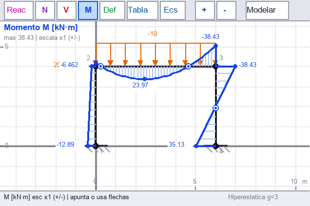
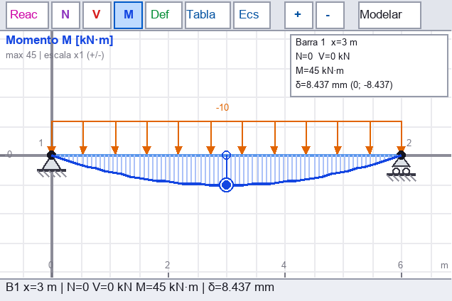
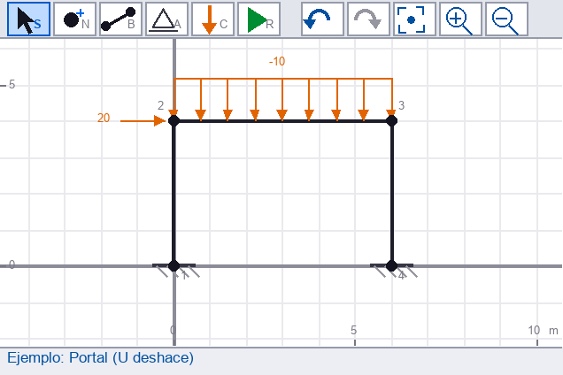
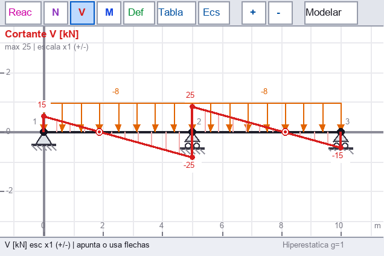
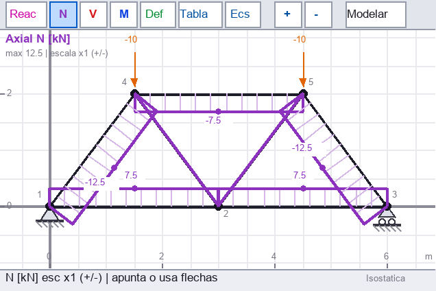
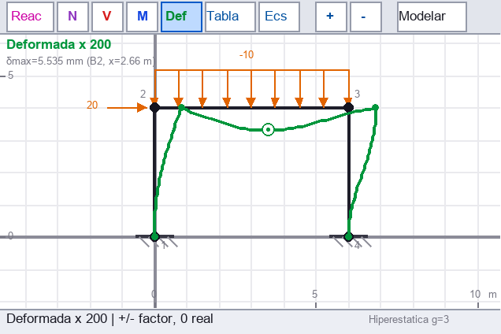
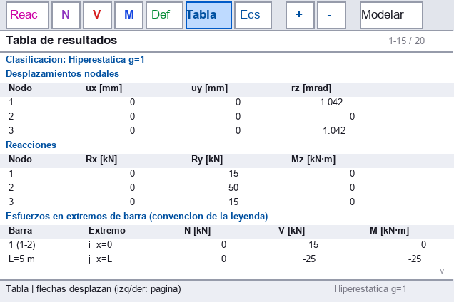
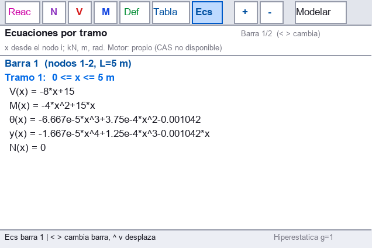

# Estructural — análisis de vigas, marcos y cerchas en la TI-Nspire CX II CAS

App en Lua para la TI-Nspire CX II / CX II CAS que modela y resuelve estructuras 2D con el **método de
rigidez directa**, con manejo gráfico inspirado en Ftool: se dibuja con el touchpad y los resultados aparecen
de inmediato.

 

## Qué hace

- **Estructuras**: vigas (continuas, voladizos, con rótulas, sobre resortes), marcos 2D con barras inclinadas y
  nudos rígidos o articulados, cerchas.
- **Apoyos**: articulado, rodillo (X o Y), empotrado, resorte (traslacional/rotacional), asentamientos.
- **Cargas**: nodales (Fx, Fy, Mz), puntual en barra, distribuida uniforme, trapezoidal/triangular (también
  parcial), momento en barra y **temperatura** (uniforme `du` y gradiente `dg`, con α y canto h). Direcciones
  global X/Y, perpendicular y axial. Cada barra o nodo tiene una **lista de cargas** para agregar, editar o
  borrar una por una; las etiquetas de varias cargas se apilan sin encimarse.
- **Dividir barras**: con Nodo o Barra, un clic en el interior de una barra inserta un nodo (con snap a lo largo
  de la barra) y la parte en dos, repartiendo cargas y conservando propiedades y rótulas; deshacer lo revierte en un paso.
- **Unidades**: kN-m (omisión), N-m (SI) o tf-m, en menú *Ajustes → Unidades* o con `q`. Se aplican a todos los
  diálogos, etiquetas, reacciones, diagramas, valor al apuntar, tabla y ecuaciones. El modelo siempre se guarda en kN, m.
- **Clasificación** en vivo: isostática, hiperestática (con grado) o inestable, con mensajes en español.
- **Resultados**: reacciones, diagramas N, V, M (momento del lado traccionado), deformada con escala ajustable o
  real, **valor al apuntar** (N, V, M, δ en cualquier punto), máximos y ceros, tabla de desplazamientos,
  reacciones y fuerzas de extremo, y **ecuaciones por tramo** V(x), M(x), θ(x), y(x) (CAS si está disponible; N(x) solo si
  no es cero), con el selector **Real / Ampliada** de la deformada. El recuadro de valores se coloca en la esquina
  opuesta al cursor para no tapar etiquetas.
- Deshacer/rehacer, ejemplos, biblioteca de modelos guardados en el documento.

| | | |
|---|---|---|
|  |  |  |
|  |  |  |

## Instalación en la calculadora

1. Descarga `Estructural.tns` (sección Releases, o genera el archivo con `python -I tools/build.py`; queda en `build/`).
2. Envíalo con **TI-Nspire Computer Link / Student Software**, o desde Chrome en
   [nspireconnect.ti.com](https://nspireconnect.ti.com): *Connect* → *Transfer file* → *To calculator*.
3. En la calculadora: *Mis documentos* → `Estructural`. Para conservar los modelos guardados, guarda el documento con `ctrl`+`S`.

## Uso rápido (viga simple en < 1 minuto)

1. La app abre en la herramienta **Barra**: clic en (0,0) y clic en (6,0) crea dos nodos y la barra. `esc` termina.
2. Tecla `a` (Apoyo): clic en el nodo 1 → *Articulado*; clic en el nodo 2 → *Rodillo X*.
3. Tecla `c` (Carga): clic en la barra → *Distribuida uniforme*, valor 10, `enter`.
4. Tecla `r` (Resolver): reacciones; luego `m`, `v`, `n`, `d` para M, V, N y la deformada. Pasa el cursor sobre la barra para leer valores.

| Tecla | Modelado | Tecla | Resultados |
|---|---|---|---|
| `s` | Seleccionar / mover (arrastre), `del` borra, `enter` edita | `r` `n` `v` `m` `d` | Reacciones, N, V, M, deformada |
| `n` | Nodo (snap a la rejilla); clic sobre una barra la **divide** | `t` / `e` | Tabla / ecuaciones por tramo |
| `b` | Barra (encadena clics); clic sobre una barra la divide | `+` `-` | Escala del diagrama o de la deformada |
| `a` / `c` | Apoyo / carga (`enter` sobre la barra: lista de cargas) | `0` | Deformada real ↔ ampliada (también el selector en pantalla) |
| `x` | Coordenadas exactas | flechas | Recorrer la barra / cambiar de barra |
| `u` / `y` | Deshacer / rehacer | `l` o `?` | Leyenda de signos |
| `e` / `+` `-` | Encuadrar / zoom | `esc` | Volver a modelar |
| `q` | Cambiar unidades (kN-m → N-m → tf-m) | `g` `k` `p` | Rejilla, snap, propiedades globales |

El menú `menu` tiene Archivo (ejemplos, guardar, abrir), Herramientas (incluye deshacer/rehacer), Vista (encuadre, zoom, deformada real/ampliada), Ajustes (unidades, rejilla, snap y propiedades globales) y Ayuda.

## Convenciones

Unidades internas kN, m, rad. Los diálogos usan las unidades del sistema elegido (por omisión kN-m: E en GPa, A en cm², I en cm⁴, desplazamientos en mm). Ejes globales: X a la derecha, Y hacia arriba,
giros antihorarios positivos. N positivo = tracción; M se dibuja del lado traccionado; `V = dM/dx`. Detalle en
[docs/arquitectura.md](docs/arquitectura.md) §3.

**Supuestos**: Euler-Bernoulli, pequeñas deformaciones, material lineal elástico, 2D estático, un estado de carga,
sin P-Δ ni deformación por cortante.

## Desarrollo

- `src/core/` núcleo numérico (rigidez, rótulas por condensación, esfuerzos como polinomios exactos por tramos),
  `src/ui/` interfaz, `src/main.lua` eventos de la Nspire.
- `python -I tools/build.py` concatena `src/**.lua` en `build/app.lua` y genera `build/Estructural.tns` con Luna.
- `bash tools/run_tests.sh` corre todas las pruebas en Lua 5.1 de escritorio con la API de la Nspire simulada (`tests/mock_nspire.lua`):
  - `test_solver`: casos con solución analítica (viga apoyada con w y con P, voladizo, empotrada-apoyada, continua, cercha, portal, rótulas, resortes, asentamientos, mecanismos), error < 1e-6.
  - `test_ref`: compara 14 casos (`tests/casos/*.json`) contra un solver independiente en NumPy (`tools/ref_numpy.py`); peor error 3e-9.
  - `test_ui`, `test_resultados`: flujo táctil completo, guardado, deshacer y pantallas de resultados, con capturas en `build/png/`.
- Documentos: [investigación (Fase 0)](docs/investigacion.md), [arquitectura y contrato](docs/arquitectura.md).
